<p align="center">
  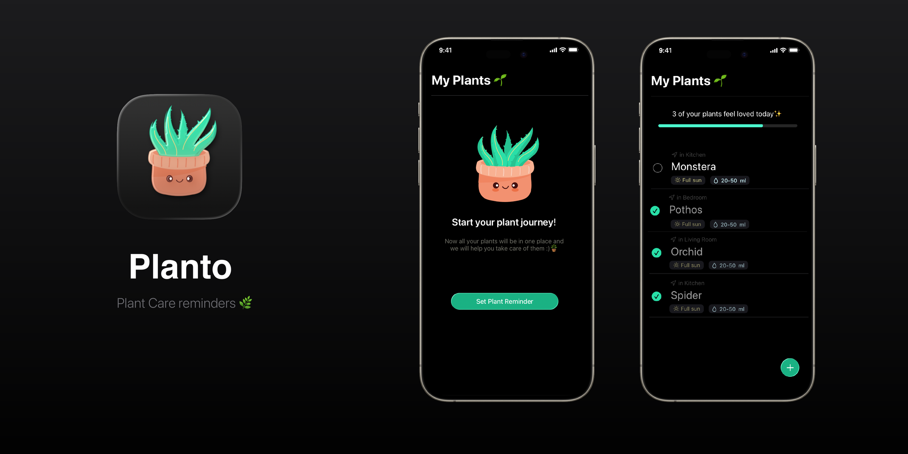
</p>

<p align="center">
  
  
  
  
  
</p>

<h1 align="center">Planto 🌱</h1>

<p align="center">
  <b>Plant Care reminders — your plants, all in one place, with a gentle nudge when they need a sip.</b>
</p>

---

## 📖 About

**Planto** is an iOS app that keeps all your plants in one place and reminds you when it's time to water each one. Add a plant, choose its room, light, and watering schedule, and the app takes care of the reminders, so no plant is ever forgotten.

---

## ✨ Main Features

| | Feature | Description |
|:-:|---|---|
| 🪴 | **Plant reminders** | Add a plant with its name, room, light, watering days, and water amount. |
| 📋 | **Today's list** | See every plant with its room, light, and water amount at a glance. |
| ✅ | **Check / uncheck** | Tap the circle to mark a plant as watered. Watered plants fade out. |
| 📊 | **Animated progress** | A progress bar fills up as you water: *"3 of your plants feel loved today ✨"*. |
| ✏️ | **Edit a plant** | Tap any plant to update its details. |
| 🗑️ | **Delete a plant** | Swipe left on a plant, or use **Delete Reminder** in the edit sheet. |
| 🔔 | **Smart notifications** | Each plant has its own reminder that keeps nudging you until it's watered, then stays quiet until the next watering day. |
| 🎉 | **All Done** | A celebration screen appears when every plant is watered. |
| 💾 | **Saved data** | Your plants stay saved after closing the app. |
| 🌗 | **Dark & Light mode** | The app follows the phone's appearance automatically. |

---

## 📱 Designs & Mockups

<p align="center">
  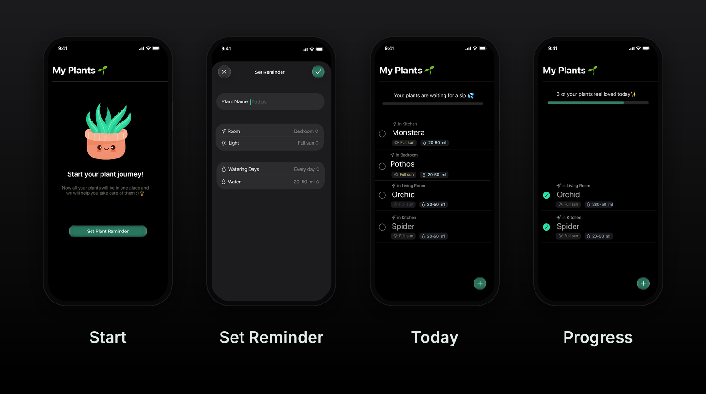
</p>

<p align="center">
  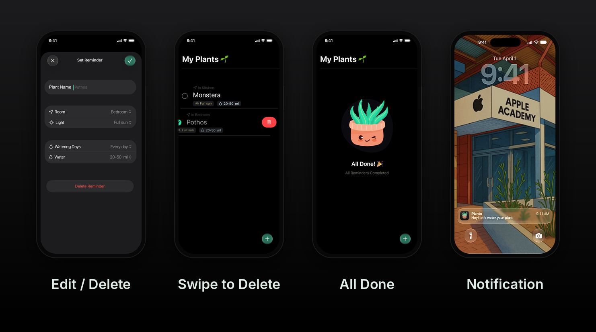
</p>

### Screens

| Screen | Preview | What it does |
|---|:-:|---|
| **Start** (Empty State) | 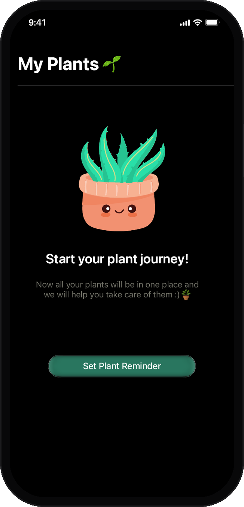 | Welcomes a new user and invites them to add their first plant. |
| **Set Reminder** | 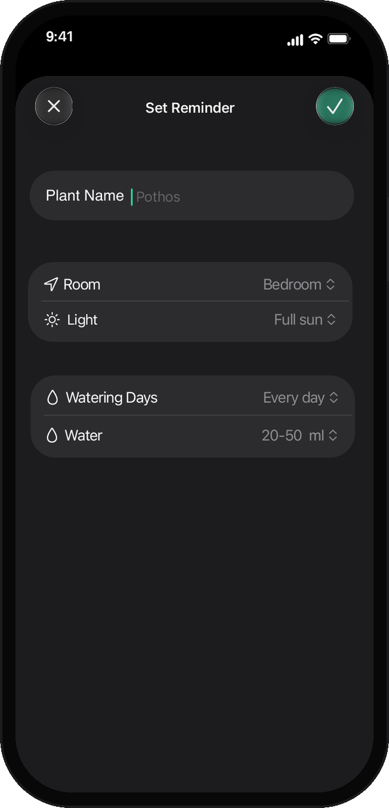 | A sheet to enter the plant's details. ✕ cancels, ✓ saves. |
| **Today Reminder** | 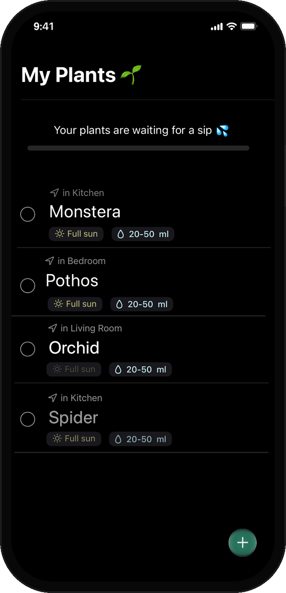 | The list of plants waiting to be watered. |
| **Progress** | 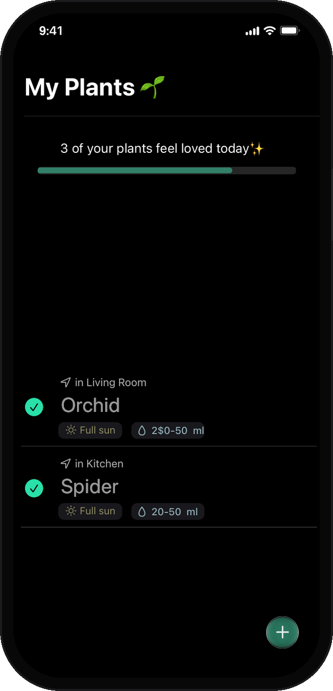 | Checked plants fade out and the progress bar fills up. |
| **Edit / Delete** | 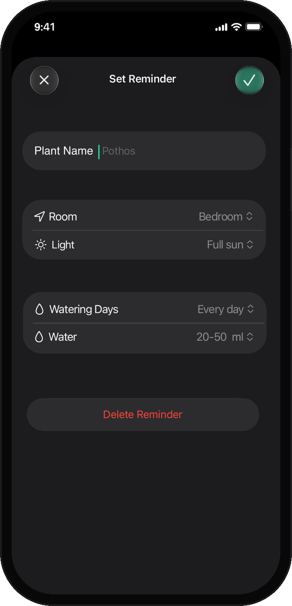 | The same sheet, filled with the plant's data, plus a Delete button. |
| **Swipe to Delete** | 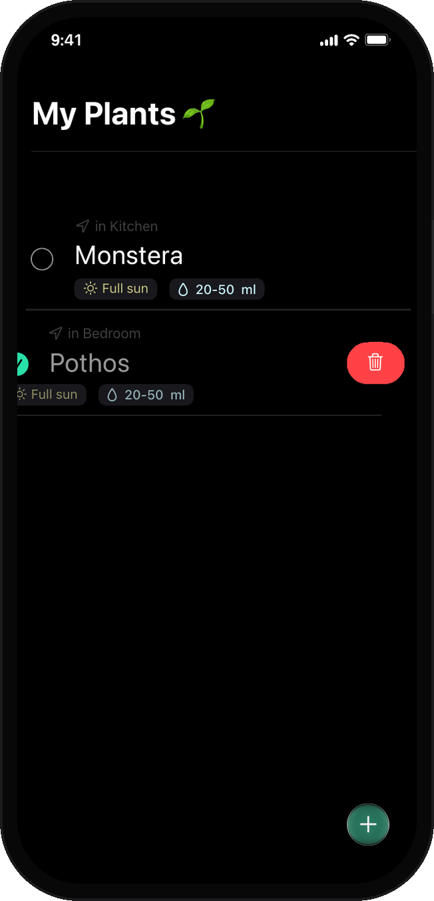 | Swipe a row left to remove the plant. |
| **All Done** | 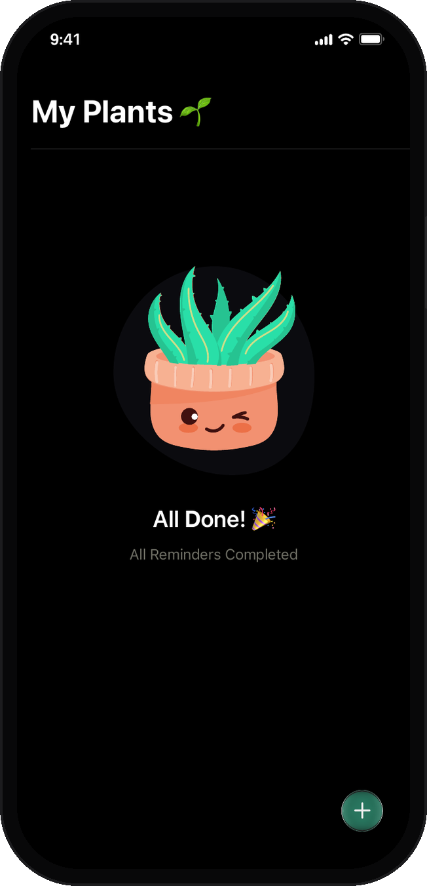 | Shown when every plant has been watered. |
| **No Reminders** | 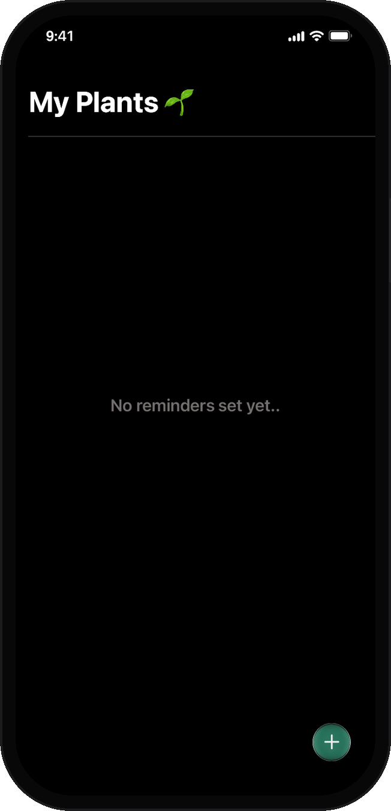 | Shown when all plants have been deleted. |
| **Notification** | 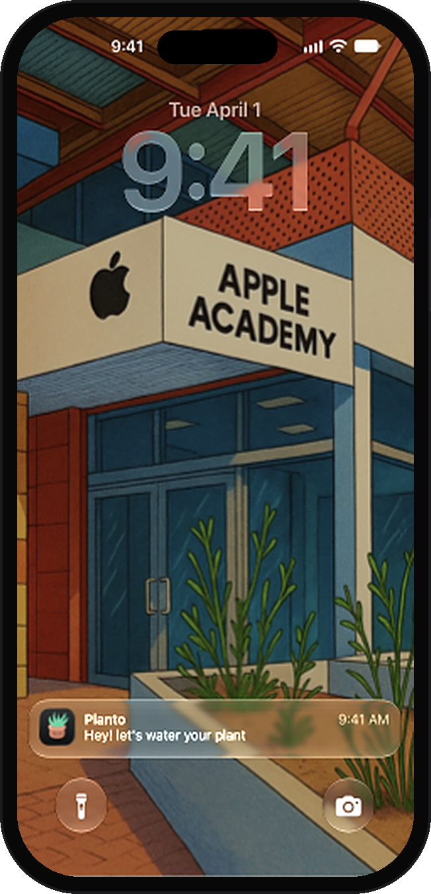 | *"Planto — Hey! let's water your plant 💧"* |

---

## 🗺️ User Flow

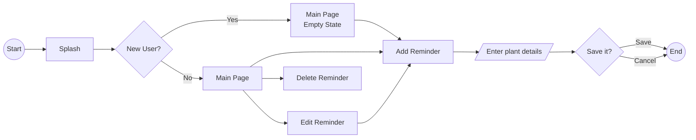

---

## 🧾 Plant Data

Every plant in the app is stored with these properties:

| Property | Type | Options |
|---|---|---|
| `name` | `String` | Any name, e.g. *Pothos* |
| `room` | `String` | Bedroom · Living Room · Kitchen · Balcony · Bathroom |
| `light` | `String` | ☀️ Full Sun · 🌤️ Partial Sun · 🌙 Low Light |
| `wateringDays` | `String` | Every day · Every 2 days · Every 3 days · Once a week · Every 10 days · Every 2 weeks |
| `water` | `String` | 20–50 ml · 50–100 ml · 100–200 ml · 200–300 ml |
| `lastWateredDate` | `Date?` | The last time the plant was watered |

---

## 🎨 Design System

### Colors

| Swatch | Name | Hex | Used for |
|:-:|---|---|---|
|  | **App Green** | `#3F7460` | Buttons, checkmarks, + button |
|  | **Mint** | `#1BB183` | Brand accent, progress bar |
|  | Background | `#000000` | Main screens (dark mode) |
|  | Sheet Gray | `#1C1C1E` | Set Reminder sheet & form rows |
|  | Primary Label | `#FFFFFF` | Titles and plant names |
|  | Secondary Label | `#8E8E93` | Rooms, hints, subtitles |
|  | Sun Chip | `#E3D27C` | Light tag |
|  | Water Chip | `#A9DFEB` | Water tag |

> All text colors use Apple's semantic colors (`.primary`, `.secondary`), and chip colors have separate light and dark values, so the app looks right in both modes.

### Typography

The app uses **SF Pro**, Apple's system font, with Dynamic Type sizes so text grows with the user's settings.

| Style | Used for |
|---|---|
| `largeTitle` · Bold | "My Plants 🌱" header |
| `title` | Plant names |
| `title2` · Bold | "Start your plant journey!" · "All Done!" |
| `subheadline` | Descriptions, rooms |
| `footnote` | Light & water chips |

### Components

- **Liquid Glass buttons** (`.glassEffect`) for *Set Plant Reminder* and the floating **+** button.
- **Form & Picker** rows for the Set Reminder sheet.
- **Chips** for light and water info.
- **Custom animated progress bar**.

---

## 🏗️ Architecture: MVVM

The project follows the **Model – View – ViewModel** pattern:

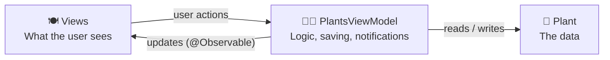

| Layer | Responsibility |
|---|---|
| **Model** | Describes a plant's data. No UI, no logic. |
| **ViewModel** | Holds the list of plants and does all the work: add, edit, delete, water, save, and schedule notifications. |
| **View** | Shows the data and sends the user's actions to the ViewModel. |

### Project Structure

```
My Plants
├── Models
│   └── Plant.swift               # Plant data + picker options
├── ViewModels
│   └── PlantsViewModel.swift     # Add / edit / delete / water / save / notifications
├── Views
│   ├── ContentView.swift         # Splash → New user? → Home or List
│   ├── SplashView.swift
│   ├── HomeView.swift            # Empty state
│   ├── ReminderView.swift        # Today's plants list
│   ├── SetReminderView.swift     # Add & edit sheet
│   ├── AllDoneView.swift
│   ├── HeaderView.swift          # "My Plants 🌱" title + divider
│   ├── PlantRowView.swift
│   ├── InfoChip.swift
│   ├── WaterProgressBar.swift
│   └── AddButton.swift
├── Assets.xcassets
└── MyApp.swift
```

---

## 🔔 How Notifications Work

| Plant status | Reminder |
|---|---|
| ⭕ **Not watered** | A reminder every day at **9:00 AM** until it's watered. |
| ✅ **Watered** | Stays quiet, then reminds you once on the next watering day. |
| 🗑️ **Deleted** | Its reminder is cancelled. |

Each plant has its **own** notification, linked to its unique ID.

---

## 🛠️ Technologies Used

- **Swift & SwiftUI**
- **MVVM** architecture
- **Observation** (`@Observable`, `@Environment`) for state management
- **UserNotifications** for local reminders
- **UserDefaults + Codable** for saving data
- **Liquid Glass** design (iOS 26)
- **SF Symbols** for icons

---

## 🚀 Getting Started

### Requirements
- iOS **26.0+**
- Xcode **26+**

### Run the app
1. Clone the repository:
   ```bash
   git clone https://github.com/YOUR-USERNAME/Planto.git
   ```
2. Open `My Plants.xcodeproj` in Xcode.
3. Choose an iPhone simulator and press **▶︎ Run**.
4. Allow notifications when asked.

---

## 📚 What I Learned

- Layout with `VStack`, `HStack`, and `ZStack`
- Custom navigation bar in a **Sheet**
- Forms: `TextField`, `Picker`, and custom input rows
- `List` and scrolling
- Custom animated `ProgressView`
- Row interactions: check / uncheck and swipe to delete
- Local notifications
- Theming and dark mode
- Organizing a project with **MVVM**

---

<p align="center">
  <b>Planto</b> · Made with 💚 by <b>Ghaida</b>
</p>
