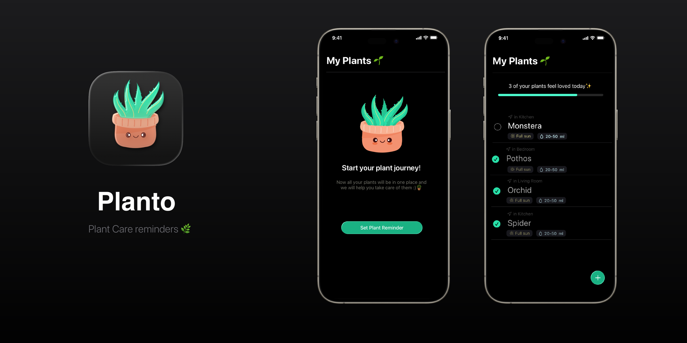
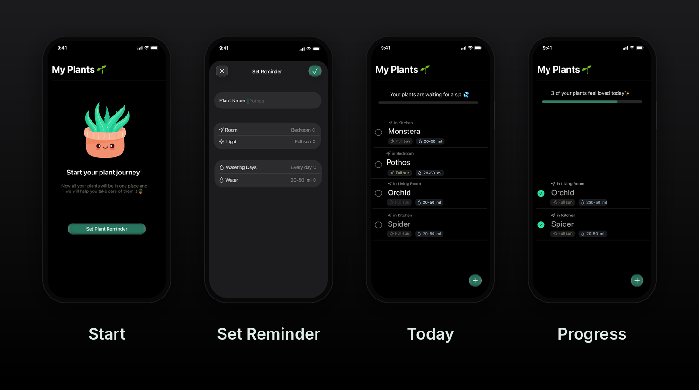
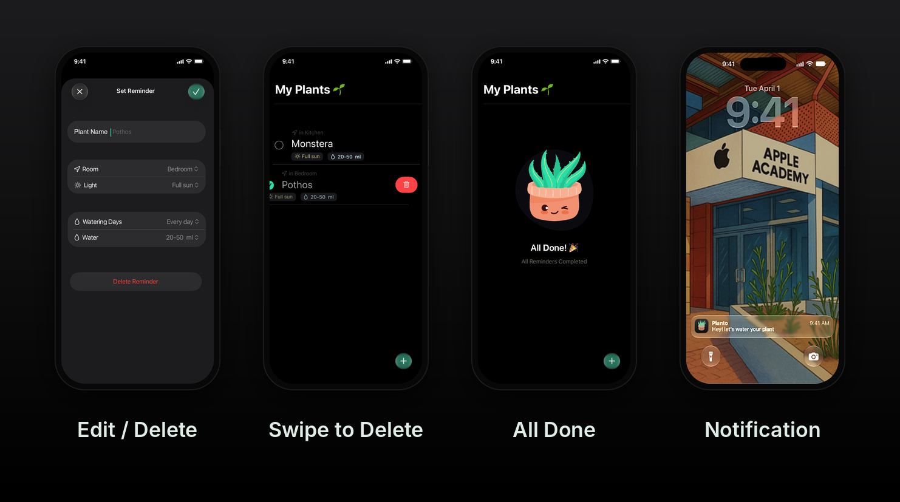

  

# Planto 🌱

Planto is an iOS app that keeps all your plants in one place and reminds you when it's time to water each one.

## Main Features

- Add a plant with its name, room, light, watering days, and water amount
- Mark plants as watered and track your progress with an animated bar
- Edit a plant, or swipe left to delete it
- Get a notification for every plant that hasn't been watered yet
- See an **All Done** screen when all your plants are watered
- Your plants stay saved after closing the app
- Supports Dark and Light mode

## Screenshots

  
  

## Technologies Used

- **Swift** & **SwiftUI**
- **MVVM** architecture
- **UserNotifications** for watering reminders
- **UserDefaults** for saving plants
- **Liquid Glass** design (iOS 26)
